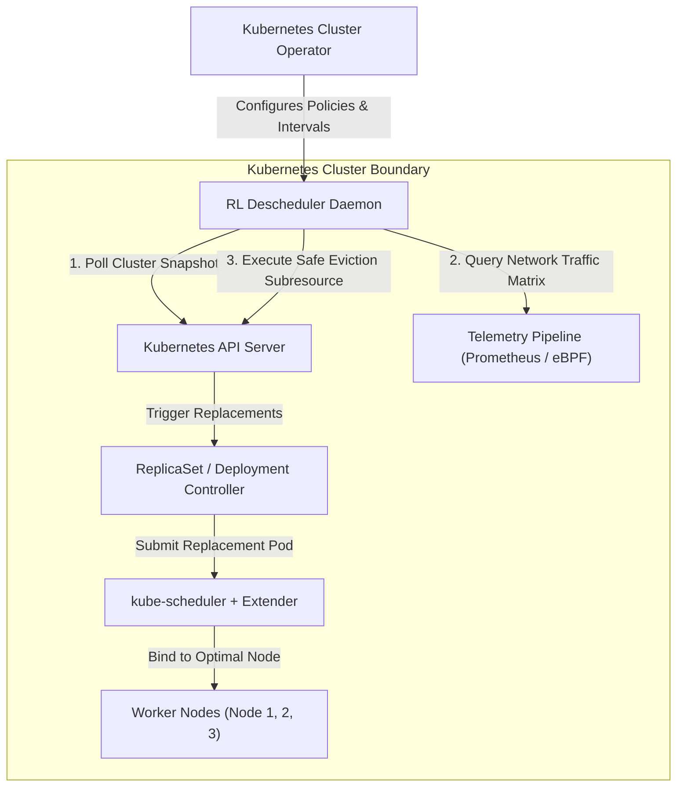
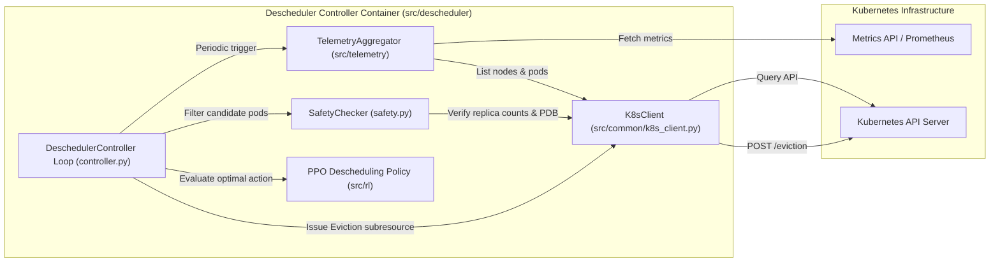
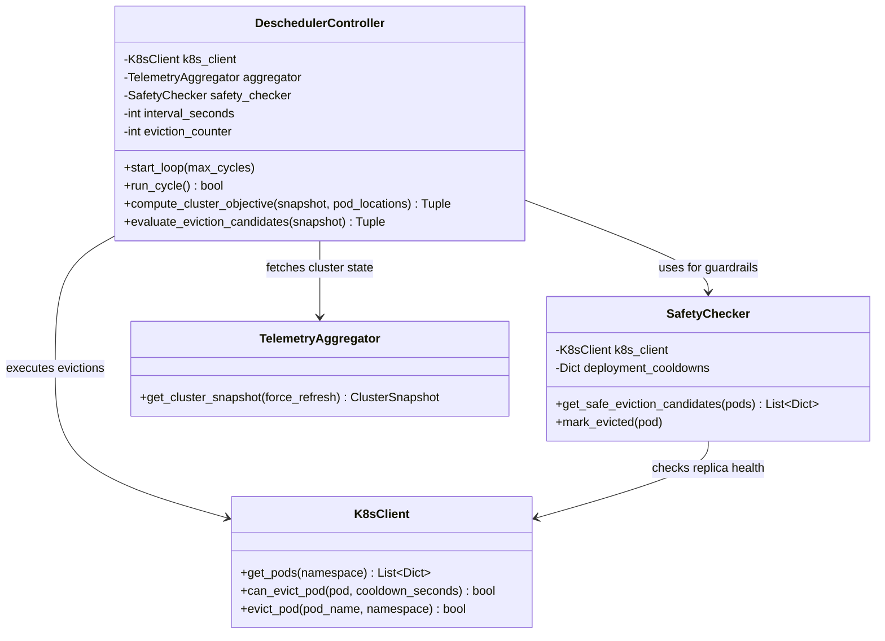
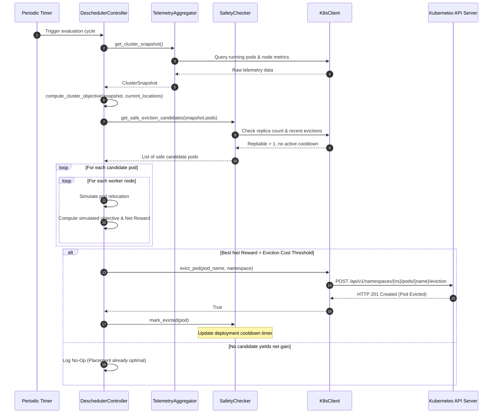
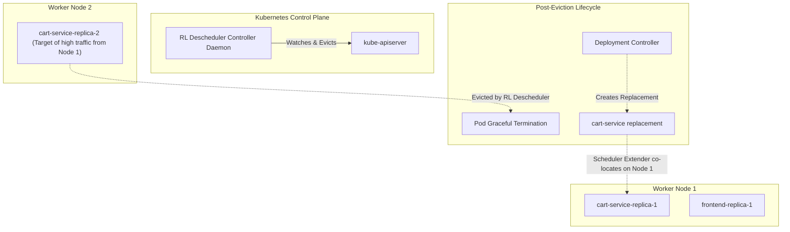

# Arc42 Architecture & Implementation: Continuous Descheduler

This document provides a comprehensive architecture and implementation specification for the **Communication-Aware Continuous Descheduler** (`src/descheduler/`), structured according to the **Arc42 architectural template** and visualised using the **C4 model** (Context, Containers, Components) via Mermaid diagrams.

> **Status:** The descheduler currently implements a **greedy heuristic exhaustive search** (Phase 0–4). A PPO RL policy is planned as a Phase 5 stretch goal (see `CLAIMS.md`). No PPO model is used in any current benchmark.

---

## 1. Introduction and Goals

### 1.1 Purpose
While the Scheduler Extender ensures optimal initial placement, Kubernetes cluster workloads drift over time due to bursty inter-service traffic, pod scaling, node resource saturation, and hardware variance. The **Continuous Descheduler** periodically audits running pods, calculates cluster-wide communication and resource variance penalties, evaluates candidate migrations using an **exhaustive greedy heuristic** (with a planned PPO RL stretch policy in Phase 5), and safely evicts victim pods via the Kubernetes Eviction Subresource API so that `kube-scheduler` can re-place them into optimal configurations.

### 1.2 Quality Goals
1. **Flapping & Churn Suppression**: Limit evictions per evaluation cycle and enforce deployment-level cooldowns to prevent thrashing.
2. **Availability & Replica Safety**: Never evict pods from single-replica workloads, unmanaged pods, or pods in critical system namespaces.
3. **Net Positive Relocation Gain**: Only evict a pod when the simulated cluster cost reduction exceeds the intrinsic overhead cost of eviction ($\text{NetReward} > \delta$).
4. **Autonomous Adaptation**: Continuously adapt to dynamically shifting traffic matrices without manual operator intervention.

---

## 2. Architecture Constraints

- **Kubernetes Eviction Subresource**: Must invoke `POST /api/v1/namespaces/{ns}/pods/{name}/eviction` (respecting Pod Disruption Budgets), rather than issuing hard `DELETE` commands.
- **Gymnasium & Stable-Baselines3**: The decision engine is powered by an RL environment (`src/rl/env/cluster_env.py`) compatible with PPO policies trained in PyTorch.
- **Non-Disruptive Background Loop**: Runs as a daemon controller with an adjustable interval (default: 30 seconds), independent of the scheduling path.

---

## 3. System Scope & Context (C4 Level 1)

---

## 4. Solution Strategy

1. **Periodic Evaluation**: Wake up every $T$ seconds (configured via `DESCHEDULER_INTERVAL_SECONDS`).
2. **Snapshot Ingestion**: Fetch running pods, active worker nodes, resource telemetry, and the live communication graph.
3. **Multi-Tier Safety Filtering**: Screen all running pods through strict guardrails (namespace, age, replica counts, cooldown history).
4. **Optimization Simulation**: For each safe candidate, simulate relocation to each candidate worker node and calculate the net objective improvement.
5. **Controlled Eviction**: If $\max(\text{NetGain}) > \text{EVICTION\_COST}$, issue an eviction subresource call for the single best victim pod and record its cooldown timestamp.

---

## 5. Building Block View

### 5.1 Container Diagram (C4 Level 2)

### 5.2 Component Diagram (C4 Level 3: `src/descheduler/`)

---

## 6. Runtime View (Sequence Diagram)

The following sequence illustrates a single evaluation cycle where an eviction is justified by communication drift:

---

## 7. Deployment View

---

## 8. Cross-Cutting Concepts

### 8.1 Cluster Objective Function
The cluster objective balances node resource variance ($RUE$) and inter-service communication latency cost ($C_{comm}$):
$$J(\mathbf{P}) = w_{res} \cdot \text{Var}(\text{NodeCPU}) \times 100 + w_{comm} \cdot \sum_{(u, v) \in E} \text{calls}(u, v) \times \text{Latency}(Node_u, Node_v)$$

When evaluating victim candidate pod $p$, the expected reward for migrating $p$ from $Node_{src}$ to $Node_{dst}$ is:
$$\text{NetReward} = \left( J(\mathbf{P}_{current}) - J(\mathbf{P}_{simulated}) \right) - \text{EVICTION\_COST}$$

An eviction is only scheduled if $\text{NetReward} > 0.05$.

### 8.2 Five-Tier Safety Guardrails
To prevent cluster degradation or flapping, the [`SafetyChecker`](file:///home/anyhow/Projects/k8s-RL-scheduler/src/descheduler/safety.py) enforces 5 sequential filters:
1. **Namespace Isolation**: Protects critical system namespaces (`kube-system`, `local-path-storage`, `monitoring`).
2. **Minimum Pod Age**: Enforces `MIN_POD_AGE_SECONDS` (default: 60s) to allow new pods to complete startup and warm-up.
3. **Owner Workload Kind**: Evicts only pods controlled by a `Deployment` or `ReplicaSet`. Standalone pods, DaemonSets, and Jobs are ignored.
4. **Deployment Cooldown Guard**: Tracks the timestamp of the last eviction per deployment, blocking subsequent evictions until `EVICTION_COOLDOWN_SECONDS` (default: 120s) has elapsed.
5. **Replica Availability Check**: Inspects the parent workload to ensure that `replicas > 1` and `ready_replicas >= (total_replicas - 1)`.

---

## 9. Architecture Decisions (ADR)

- **ADR-D01: Eviction API vs. Direct Node Binding**: Kubernetes pods are immutable once bound to a node; a pod cannot be dynamically live-migrated across nodes. The descheduler uses the official Kubernetes Eviction subresource API to trigger a recreation cycle, allowing the Scheduler Extender to handle the re-placement.
- **ADR-D02: Single-Eviction-Per-Cycle Policy**: Enforces `MAX_EVICTIONS_PER_CYCLE = 1` to guarantee convergence and allow the cluster topology to stabilize before the next evaluation cycle.
- **ADR-D03: Simulation-Based Predictive Safety**: Relocation benefits are simulated before executing an eviction, eliminating arbitrary or degrading evictions typical in naive heuristic deschedulers.
