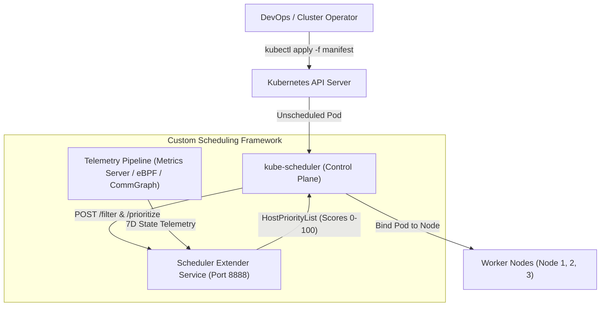
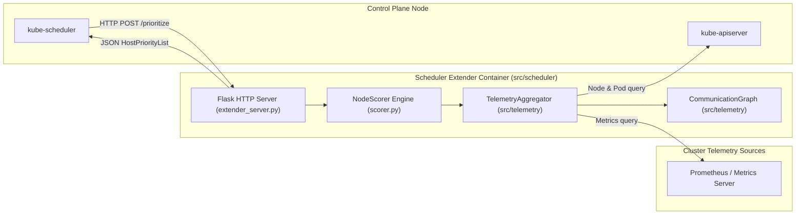
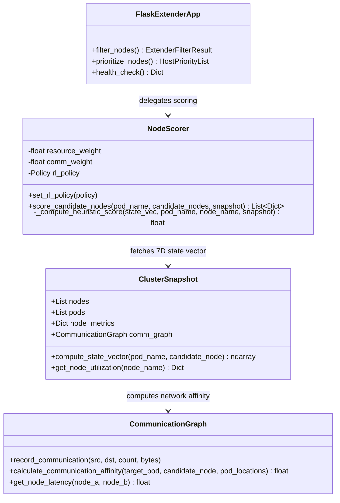
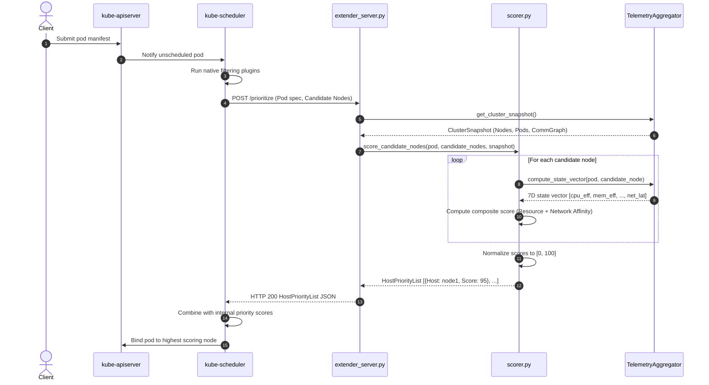
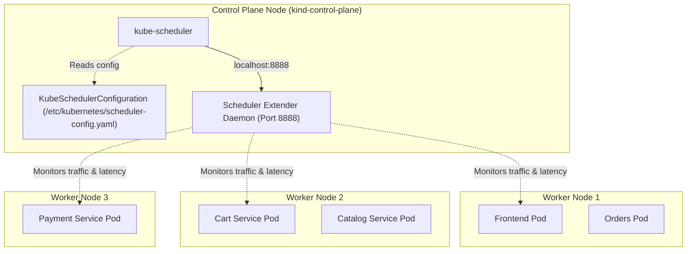

# Arc42 Architecture & Implementation: Communication-Aware Scheduler Extender

This document provides a comprehensive architecture and implementation specification for the **Communication-Aware Scheduler Extender** (`src/scheduler/`), structured according to the **Arc42 architectural template** and visualised using the **C4 model** (Context, Containers, Components) via Mermaid diagrams.

---

## 1. Introduction and Goals

### 1.1 Purpose
The default Kubernetes scheduler (`kube-scheduler`) evaluates resource requests statically at pod creation time without considering inter-service communication patterns or dynamic network latencies. The Scheduler Extender augments `kube-scheduler` by intercepting initial pod scheduling decisions, computing a 7-dimensional infrastructure and network affinity state vector, and ranking candidate nodes to minimize inter-node communication bottlenecks.

### 1.2 Quality Goals
1. **Low Scheduling Latency**: Complete node filtering and scoring within < 50ms per pod evaluation.
2. **Communication Affinity Optimization**: Colocate frequently communicating pods on the same worker node or within the same low-latency zone.
3. **Cluster Resource Balance**: Prevent hotspots by balancing CPU and Memory utilization alongside communication affinity.
4. **Resilience & Fallback**: Degrade gracefully to native kube-scheduler scoring heuristics if the telemetry pipeline or RL policy is unavailable.

---

## 2. Architecture Constraints

- **Kubernetes Extender Protocol**: Must strictly conform to the native Kubernetes Scheduler Extender JSON HTTP payload contract (`ExtenderArgs`, `ExtenderFilterResult`, `HostPriorityList`).
- **Stateless Scoring**: Extender endpoints must remain idempotent and stateless, relying on cached telemetry snapshots from the Aggregator.
- **Python / Flask Runtime**: Implemented in Python 3.11+ using lightweight Flask web server, integrated with NumPy and PyTorch/Stable-Baselines3.

---

## 3. System Scope & Context (C4 Level 1)

The Scheduler Extender operates as an external webhook service invoked directly by the Kubernetes Control Plane during the scheduling pipeline.

---

## 4. Solution Strategy

1. **Extender Integration**: Expose two REST endpoints (`/filter` and `/prioritize`) compatible with `KubeSchedulerConfiguration`.
2. **7D State Feature Extraction**: For each candidate node, construct a feature vector:
   $$s = [cpu\_eff, mem\_eff, node\_cpu, node\_mem, disk\_io, net\_lat, node\_temp]$$
3. **Composite Scoring**: Combine normalized resource balance scores and communication affinity scores into an integer score in the range `[0, 100]`.
4. **Deterministic Heuristic Scoring (RL Path Unverified)**: Uses a deterministic weighted heuristic scoring function. Note: As documented in `CLAIMS.md` and Rule 4.10, the RL policy scoring path (`predict()`) is currently unverified due to Defect D5 (feeding a 7D vector into a 42D model) and must NOT silently fall back to heuristic while claiming RL inference.

---

## 5. Building Block View

### 5.1 Container Diagram (C4 Level 2)

### 5.2 Component Diagram (C4 Level 3: `src/scheduler/`)

---

## 6. Runtime View (Sequence Diagram)

The following sequence illustrates the complete life cycle of an unscheduled pod being prioritized by the Scheduler Extender:

---

## 7. Deployment View

In a multi-node Kubernetes cluster (e.g. Kind or production bare-metal):

---

## 8. Cross-Cutting Concepts

### 8.1 7-Dimensional State Vector
For any given pod $p$ and candidate node $n$, the state vector is structured as:
1. $cpu\_eff \in [0, 1]$: Predicted CPU headroom efficiency post-placement.
2. $mem\_eff \in [0, 1]$: Predicted memory headroom efficiency post-placement.
3. $node\_cpu \in [0, 1]$: Current node CPU saturation.
4. $node\_mem \in [0, 1]$: Current node memory saturation.
5. $disk\_io \in [0, 1]$: Disk I/O load factor.
6. $net\_lat \in [0, 1]$: Weighted network latency to communicating peer pods.
7. $node\_temp \in [0, 1]$: Node thermal throttling / hardware health coefficient.

### 8.2 Heuristic Scoring Formula
$$\text{ResourceScore} = \frac{cpu\_eff + mem\_eff}{2}$$
$$\text{CommScore} = 1.0 - net\_lat$$
$$\text{CompositeScore} = w_{res} \cdot \text{ResourceScore} + w_{comm} \cdot \text{CommScore}$$
Normalized into integer range $[0, 100]$:
$$\text{Score}(n) = \text{round}\left(\frac{\text{CompositeScore}(n) - \min(S)}{\max(S) - \min(S) + \epsilon} \times 100\right)$$

---

## 9. Architecture Decisions (ADR)

- **ADR-01: Extender Pattern vs. Out-of-Tree Scheduler Binary**: Selected the Kubernetes Scheduler Extender webhook pattern over recompiling `kube-scheduler` in Golang. This allows running advanced Python RL engines (PyTorch, SB3) natively without Go-to-Python C-bindings or gRPC serialization overhead.
- **ADR-02: Strict Normalization Range**: Normalized final node scores to `[0, 100]` matching Kubernetes default weight scales, ensuring smooth composition with native scheduler priority plugins.
- **ADR-03: Two-Phase Degradation**: If the trained PPO policy model cannot be loaded, scoring seamlessly degrades to the closed-form deterministic heuristic without returning 500 errors to `kube-scheduler`.
